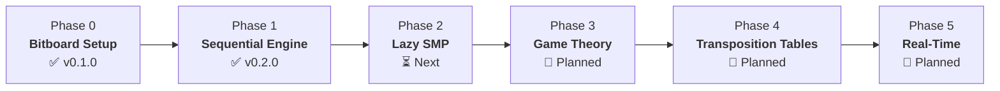

# minimax-parallel-benchmark

High-performance computing (HPC) research repository benchmarking **Parallel Minimax (Lazy SMP)** against pure **Sequential Alpha-Beta Pruning** and heavy evaluation heuristics on dense decision trees using **Connect 4**.

---

## 🚦 Roadmap & Implementation Status

| Phase | Milestone | Tag / Release | Status | Key Highlights |
| :--- | :--- | :---: | :---: | :--- |
| **Phase 0** | **Setup & Bitboard Core** | [`v0.1.0-phase0`](https://github.com/a-delavega/minimax-parallel-benchmark/releases/tag/v0.1.0-phase0) | ✅ Complete | 32-byte Bitboard, $O(1)$ shifts, row-6 sentinel bits, CMake C++20 |
| **Phase 1** | **Sequential Engine & Heuristics** | [`v0.2.0-phase1`](https://github.com/a-delavega/minimax-parallel-benchmark/releases/tag/v0.2.0-phase1) | ✅ Complete | Minimax vs Alpha-Beta, ComplexEvaluator, Catch2 tests, Benchmarks |
| **Phase 2** | **Lazy SMP Concurrency (Core)** | `v0.3.0-phase2` | ⏳ Up Next | Multi-threaded search sharing $[\alpha, \beta]$ windows via `std::thread` |
| **Phase 3** | **Game Theory & Suboptimal Opponents** | `v0.4.0-phase3` | 📅 Planned | Exploitative pruning against erratic agents |
| **Phase 4** | **Transposition Tables & Zobrist Hash** | `v0.5.0-phase4` | 📅 Planned | Lock-free concurrent hash table to eliminate transpositions |
| **Phase 5** | **Real-Time Control & Iterative Deepening** | `v0.6.0-phase5` | 📅 Planned | Strict 50ms deadlines & dynamic time management |

---

## 📌 Project Architecture



---

## 🔬 Mathematical Representation: 64-bit Bitboard

The game state is represented entirely within **two 64-bit unsigned integers** (`bitboard[0]` for Player 1, `bitboard[1]` for Player 2).

### Column-Major Layout with Sentinel Bits

To eliminate array lookups and branch mispredictions, the 7x6 board is mapped using **7 bits per column** (rows 0–5 for playable cells, row 6 reserved as a **sentinel bit** always set to `0`):

```text
bit_index = column * 7 + row
```

```
  Col:    0     1     2     3     4     5     6
       +-----+-----+-----+-----+-----+-----+-----+
Row 6  |  6  | 13  | 20  | 27  | 34  | 41  | 48  |  <-- SENTINEL BITS (Always 0)
Row 5  |  5  | 12  | 19  | 26  | 33  | 40  | 47  |  <-- Top playable row
Row 4  |  4  | 11  | 18  | 25  | 32  | 39  | 46  |
Row 3  |  3  | 10  | 17  | 24  | 31  | 38  | 45  |
Row 2  |  2  |  9  | 16  | 23  | 30  | 37  | 44  |
Row 1  |  1  |  8  | 15  | 22  | 29  | 36  | 43  |
Row 0  |  0  |  7  | 14  | 21  | 28  | 35  | 42  |  <-- Bottom row
       +-----+-----+-----+-----+-----+-----+-----+
```

### Why the Sentinel Bit Matters

During diagonal win detection, bit shifts of ±6 (ascending diagonal `/`) and ±8 (descending diagonal `\`) could wrap across column boundaries and trigger false-positive 4-in-a-row detections. 

By enforcing row 6 to remain `0` permanently, any diagonal shift attempting to spill into the adjacent column is masked out by a logical `AND` with zero, ensuring correctness in O(1) with **zero branching**.

### O(1) Win Detection via Bit Shifts

A 4-in-a-row in any direction `d` is determined by two consecutive shifts:

```cpp
mask    = b & (b >> d)
has_won = (mask & (mask >> (2 * d))) != 0
```

- **Vertical**: `d = 1`
- **Horizontal**: `d = 7`
- **Diagonal (`/`)**: `d = 6`
- **Diagonal (`\`)**: `d = 8`

---

## ⚡ Thread-Safety & Memory Footprint

- `sizeof(Board)` is **32 bytes**, fitting easily within a single L1 cache line (typically 64 bytes).
- Zero heap allocations (`malloc`/`new`).
- Completely self-contained: each search worker in Phase 2 can copy the board by value directly into registers/stack without mutex synchronization.

---

## 🛠️ Build & Installation

The project requires a **C++20** compliant compiler and **CMake 3.25+**.

### Linux / WSL (GCC 11+ / Clang 13+)

```bash
cmake -B build -DCMAKE_BUILD_TYPE=Release
cmake --build build -j$(nproc)

# Run the smoke test
./build/mmb_runner

# Run the board visualizer tool
./build/tools/pretty_print
```

### Windows (MSVC 2022)

```powershell
cmake -B build -DCMAKE_BUILD_TYPE=Release
cmake --build build --config Release

# Run executables
.\build\Release\mmb_runner.exe
.\build\tools\Release\pretty_print.exe
```

### CMake Options

| Flag | Default | Description |
|---|---|---|
| `MMB_BUILD_TOOLS` | `ON` | Build CLI debug visualizer (`pretty_print`) |
| `MMB_BUILD_TESTS` | `OFF` | Build unit test suite (Catch2 / GTest) |
| `MMB_BUILD_BENCHMARKS` | `OFF` | Build Google Benchmark microbenchmarks |

---

## 📄 License

MIT License. See `LICENSE` for details.
