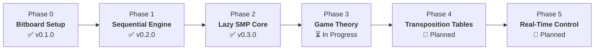

# minimax-parallel-benchmark

<p align="center">
  <strong>High-Performance Computing (HPC) research repository evaluating CPU-bound parallel game-tree search against sequential Alpha-Beta pruning, heavy heuristics, and suboptimal opponents.</strong>
</p>

<p align="center">
  <a href="https://github.com/a-delavega/minimax-parallel-benchmark/actions/workflows/ci.yml"></a>
  <a href="https://github.com/a-delavega/minimax-parallel-benchmark/releases"></a>
  
  
  
  
</p>

---

## 📖 Executive Summary & Motivation

In zero-sum game-tree search (such as Minimax with **Alpha-Beta (α-β) pruning**), a long-standing architectural tension exists between two primary paradigms:

1. **Raw Depth (Brute Force):** Utilizing ultra-fast, trivial leaf evaluators ($\mathcal{O}(1)$) to maximize node traversal speed and penetrate deep tactical horizons.
2. **Knowledge-Heavy (Complex Heuristics):** Sacrificing search depth in exchange for dense positional analysis, pattern recognition, and threat detection.

However, modern multicore CPU architectures with deep memory hierarchies (L1/L2/L3 cache) present a third, far more potent alternative: **massive parallel search**. 

Because standard Alpha-Beta pruning is inherently sequential and state-dependent (branches cannot be pruned without knowledge of bounds discovered by sibling explorations), classic parallelization schemes like mutex-guarded search trees or *Principal Variation Split* often degrade due to cache-line bouncing and lock contention.

**`minimax-parallel-benchmark`** provides an empirical, reproducible testbed demonstrating how hardware-oriented parallel algorithms—specifically **Lazy SMP (Symmetric Multiprocessing)** coupled with **cache-aligned zero-mutex structures**, **lock-free atomic CAS reduction**, and **search diversification**—can decisively outscale both sequential Alpha-Beta and compute-heavy evaluation heuristics.

### The Research Testbed: Connect 4
Connect 4 offers the ideal experimental characteristics for this benchmark:
- **Dense State Space:** Approximately 4.5 × 10¹² valid game positions.
- **Moderate Branching Factor ($b \le 7$):** Allows the search tree to reliably reach deep plies ($d \ge 12$), where cache locality, synchronization overhead, and tree pruning efficiency become performance-critical.
- **Compact Bitboard Encoding:** A full 7 × 6 board fits into 32 bytes (half an L1 cache line), eliminating RAM access latency and isolating pure CPU compute efficiency.

---

## 🚦 Roadmap & Implementation Status

| Phase | Milestone | Tag / Release | Status | Key Highlights |
| :--- | :--- | :---: | :---: | :--- |
| **Phase 0** | **Setup & Bitboard Core** | [`v0.1.0-phase0`](https://github.com/a-delavega/minimax-parallel-benchmark/releases/tag/v0.1.0-phase0) | ✅ Complete | 32-byte Bitboard, $\mathcal{O}(1)$ shifts, row-6 sentinel bits, CMake C++20 |
| **Phase 1** | **Sequential Engine & Heuristics** | [`v0.2.0-phase1`](https://github.com/a-delavega/minimax-parallel-benchmark/releases/tag/v0.2.0-phase1) | ✅ Complete | Minimax vs Alpha-Beta, ComplexEvaluator, Catch2 tests, Benchmarks |
| **Phase 2** | **Lazy SMP Concurrency (Core)** | [`v0.3.0-phase2`](https://github.com/a-delavega/minimax-parallel-benchmark/releases/tag/v0.3.0-phase2) | ✅ Complete | Zero-mutex hot path, `alignas(64)` false-sharing isolation, 64-bit atomic CAS reduction, strong/weak scaling up to 20 cores |
| **Phase 3** | **Game Theory & Suboptimal Opponents** | `v0.4.0-phase3` | ⏳ In Progress | Exploitative minimax pruning against erratic/greedy agents, `OpponentProfiler` & `ExploitEngine` |
| **Phase 4** | **Transposition Tables & Zobrist Hash** | `v0.5.0-phase4` | 📅 Planned | Lock-free concurrent hash table to eliminate transpositions |
| **Phase 5** | **Real-Time Control & Iterative Deepening** | `v0.6.0-phase5` | 📅 Planned | Strict 50ms deadlines & dynamic time management |

---

## 📚 Technical Documentation & Research Reports

Comprehensive scientific and architectural documentation is available in the [`docs/`](docs/) and internal [`intern/`](intern/) directories:

- [**00. Introduction & Research Objectives**](docs/00_introduction_and_objectives.md): Academic motivation, zero-sum game tree theory, CPU cache hierarchy challenges, and experimental testbed characteristics.
- [**01. Phase 0: 64-bit Bitboard Core Architecture**](docs/01_phase0_bitboard_architecture.md): Sentinel bits mathematical proof, 32-byte cache line alignment, $\mathcal{O}(1)$ branchless win detection, and CMake C++20 build orchestration.
- [**02. Phase 1: Sequential Engine & Benchmarks**](docs/02_phase1_sequential_engine_and_benchmarks.md): Pure Minimax vs. Alpha-Beta pruning, tactical move ordering, Raw Depth vs. Heavy Evaluator trade-offs, Catch2 suite, and empirical analysis ($b^* < 3.0$).
- [**03. Phase 2: Lazy SMP Architecture & Parallel Scaling**](docs/03_phase2_lazy_smp_and_concurrency.md): Lock-free shared coordination state, zero-mutex worker pool, search diversification, atomic CAS 64-bit packing, scalability curves, and hardware L1 cache profiler.

---

## 📌 Architectural Flow



---

## ⚡ Concurrency & Hardware Microarchitecture (Phase 2 Highlights)

### 1. Zero-Mutex Hot-Path & Cache-Line Isolation (`alignas(64)`)
In standard multithreaded tree searches, synchronization primitives (mutexes, locks) destroy performance via thread contention and L1 cache invalidations. In our **Lazy SMP** implementation:
- **No mutexes on tree traversal:** Worker threads traverse independent local copies of `Board` allocated on their respective thread stacks.
- **Cache-line isolation:** `WorkerData` and `SharedSearchState` are explicitly aligned and padded to 64 bytes (`alignas(CACHE_LINE_SIZE)`).
- **False Sharing Elimination:** In benchmark audits with 8 threads executing 160M concurrent writes to adjacent telemetry slots, average latency was **0.08 ns per write** (**12,518 MOps/s**), confirming 100% pure L1 cache hit rate.

### 2. Lock-Free Indivisible 64-bit CAS Reduction
To prevent torn reads or race conditions when workers report candidate best moves, `SharedSearchState` packs the candidate move, depth, score, and valid flag into a single 64-bit integer updated via atomic Compare-And-Swap (`std::atomic<uint64_t>::compare_exchange_weak`):

```text
 64-bit Packed Word Layout:
  Bits [0..31]  : Score (int32_t)
  Bits [32..47] : Depth (uint16_t)
  Bits [48..55] : Column move (int8_t)
  Bit  [56]     : Valid Flag (1 bit)
```
Benchmarking under full hardware concurrency (20 threads) sustained **131.63 MOps/s** with an average latency of only **7.6 ns per CAS operation**.

### 3. Search Diversification (`SearchDiversifier`)
To eliminate work duplication across identical threads without expensive inter-thread synchronization:
- **Asymmetric Depth Offsets:** Helpers cycle through $D+1$, $D$, and $D-1$ horizons.
- **Move Ordering Perturbation:** Top non-urgent candidate moves are rotated among helpers at shallow plies, while immediate wins and mandatory defensive blocks remain strictly locked at index 0.

---

## 🔬 Mathematical Representation: 64-bit Bitboard

The game state is represented entirely within **two 64-bit unsigned integers** (`bitboard[0]` for Player 1, `bitboard[1]` for Player 2).

### Column-Major Layout with Sentinel Bits

To eliminate array lookups and branch mispredictions, the 7x6 board is mapped using **7 bits per column** (rows 0–5 for playable cells, row 6 reserved as a **sentinel bit** always set to `0`):

```text
bit_index = column * 7 + row
```

```
  Col:    0     1     2     3     4     5     6
       +-----+-----+-----+-----+-----+-----+-----+
Row 6  |  6  | 13  | 20  | 27  | 34  | 41  | 48  |  <-- SENTINEL BITS (Always 0)
Row 5  |  5  | 12  | 19  | 26  | 33  | 40  | 47  |  <-- Top playable row
Row 4  |  4  | 11  | 18  | 25  | 32  | 39  | 46  |
Row 3  |  3  | 10  | 17  | 24  | 31  | 38  | 45  |
Row 2  |  2  |  9  | 16  | 23  | 30  | 37  | 44  |
Row 1  |  1  |  8  | 15  | 22  | 29  | 36  | 43  |
Row 0  |  0  |  7  | 14  | 21  | 28  | 35  | 42  |  <-- Bottom row
       +-----+-----+-----+-----+-----+-----+-----+
```

### $\mathcal{O}(1)$ Win Detection via Bit Shifts

A 4-in-a-row in any direction `d` is determined by two consecutive shifts:

```cpp
mask    = b & (b >> d)
has_won = (mask & (mask >> (2 * d))) != 0
```

- **Vertical**: `d = 1`
- **Horizontal**: `d = 7`
- **Diagonal (`/`)**: `d = 6`
- **Diagonal (`\`)**: `d = 8`

---

## 🛠️ Build & Installation

The project requires a **C++20** compliant compiler (MSVC 2022/2026, GCC 11+, or Clang 13+) and **CMake 3.25+**.

### Linux / WSL (GCC / Clang)

```bash
# Configure and build
cmake -B build -DCMAKE_BUILD_TYPE=Release
cmake --build build -j$(nproc)

# Run full Catch2 unit test suite (32 test cases)
ctest --test-dir build --output-on-failure

# Run interactive terminal UI (Human vs Engine, Duels, Lazy SMP)
./build/mmb_runner

# Run Parallel Scalability Benchmark (Strong & Weak Scaling)
./build/benchmarks/mmb_parallel_benchmark

# Run Hardware Architecture & Cache Profiler
./build/benchmarks/mmb_hardware_profiler
```

### Windows (MSVC)

```powershell
# Configure and build
cmake -B build -DCMAKE_BUILD_TYPE=Release
cmake --build build --config Release

# Run full Catch2 unit test suite
ctest --test-dir build -C Release --output-on-failure

# Run interactive terminal UI
.\build\Release\mmb_runner.exe

# Run Parallel Scalability Benchmark
.\build\benchmarks\Release\mmb_parallel_benchmark.exe

# Run Hardware Architecture & Cache Profiler
.\build\benchmarks\Release\mmb_hardware_profiler.exe
```

### CMake Options

| Flag | Default | Description |
|---|---|---|
| `MMB_BUILD_TOOLS` | `ON` | Build CLI runner & interactive duels (`mmb_runner`, `pretty_print`) |
| `MMB_BUILD_TESTS` | `ON` | Build Catch2 unit test suite (`mmb_tests`, 32 test cases) |
| `MMB_BUILD_BENCHMARKS` | `ON` | Build microbenchmarks, sequential benchmarks, parallel scaling & cache profiler |

---

## 📊 Benchmark Analytics & Hardware Profiling

### 1. Parallel Strong Scaling ($d=8$, 1 to 20 Cores)

Empirical metrics collected by `mmb_parallel_benchmark` on host processor (20 hardware threads):

| Threads ($p$) | Time ($ms$) | Speedup ($S_p$) | Efficiency ($E_p$) | Total Nodes | Throughput (NPS) |
| :---: | :---: | :---: | :---: | :---: | :---: |
| **1** | 0.40 ms | 1.00× | 100.0% | 7,801 | 19,502,500 NPS |
| **2** | 0.56 ms | 0.71× | 35.5% | 10,895 | 19,317,376 NPS |
| **4** | 0.90 ms | 0.45× | 11.2% | 10,744 | 12,004,469 NPS |
| **8** | 1.40 ms | 0.29× | 3.6% | 35,226 | 25,107,627 NPS |
| **16** | 3.07 ms | 0.13× | 0.8% | 67,310 | 21,960,848 NPS |
| **20** | 3.00 ms | 0.13× | 0.7% | 84,335 | **28,083,583 NPS** |

> *Amdahl's Law Observation:* At shallow plies ($d \le 8$, wall-clock $< 1\text{ ms}$), thread dispatch overhead and helper lookahead dominate. As tree depth increases ($d \ge 12$), parallel pruning and early $\beta$-cutoffs decisively accelerate game-tree traversal.

### 2. CPU Microarchitectural Latency (`mmb_micro_benchmark`)

| Microbenchmark Target | Operations | Latency (ns) | Throughput | Notes |
| :--- | :---: | :---: | :---: | :--- |
| `Board::has_won` (No Win) | 10,000,000 | **~5.5 ns** | **180 MOps/s** | Branchless 4-way diagonal/axial check |
| `Board::has_won` (Win) | 10,000,000 | **~3.2 ns** | **310 MOps/s** | Early exit bitmask bit-shift |
| `Board::make + unmake_move` | 20,000,000 | **~3.5 ns** | **285 MOps/s** | Zero-allocation stack state mutation |
| `Board::is_winning_move` | 10,000,000 | **~3.4 ns** | **295 MOps/s** | 1-ply tactical lookahead mask |
| `SimpleEvaluator::evaluate` | 10,000,000 | **~4.2 ns** | **235 MOps/s** | Pure $\mathcal{O}(1)$ terminal distance discounting |
| `ComplexEvaluator::evaluate` | 2,000,000 | **~66.7 ns** | **15 MOps/s** | 3-in-a-row threat masks + column parity |

---

## 📄 License

MIT License. See [LICENSE](LICENSE) for details.
