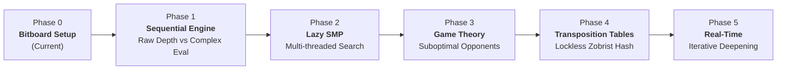

# minimax-parallel-benchmark

High-performance computing (HPC) research repository benchmarking **Parallel Minimax (Lazy SMP)** against pure **Sequential Alpha-Beta Pruning** and heavy evaluation heuristics on dense decision trees using **Connect 4**.

---

## 📌 Project Vision & Roadmap

The primary goal of this research is to evaluate CPU-bound parallel game-tree search strategies, analyzing thread scalability, cache utilization, and transposition table efficiency.



- **Phase 0 (Setup & Bitboard Core)**: High-performance 64-bit Bitboard representation, $O(1)$ move generation and win detection, cross-platform CMake build system.
- **Phase 1 (Sequential Engine)**: Minimax with Alpha-Beta pruning; empirical comparison between raw search depth with trivial evaluation vs. shallow search with heavy pattern heuristics.
- **Phase 2 (Lazy SMP - The Core)**: Multi-threaded tree search sharing Alpha-Beta search windows via `std::thread` without mutex contention on the hot path.
- **Phase 3 (Game Theory & Adaptability)**: Exploitative adjustments against suboptimal or erratic opponents.
- **Phase 4 (Memory & Caching)**: Lock-free Transposition Tables backed by Zobrist Hashing to prune transposed game states across threads.
- **Phase 5 (Real-Time Control)**: Iterative Deepening search bounded by strict time limits (e.g., 50ms deadlines).

---

## 🔬 Mathematical Representation: 64-bit Bitboard

The game state is represented entirely within **two 64-bit unsigned integers** (`bitboard[0]` for Player 1, `bitboard[1]` for Player 2).

### Column-Major Layout with Sentinel Bits

To eliminate array lookups and branch mispredictions, the $7 \times 6$ board is mapped using **7 bits per column** (rows 0–5 for playable cells, row 6 reserved as a **sentinel bit** always set to `0`):

$$\text{bit\_index} = \text{column} \times 7 + \text{row}$$

```
  Col:    0     1     2     3     4     5     6
       +-----+-----+-----+-----+-----+-----+-----+
Row 6  |  6  | 13  | 20  | 27  | 34  | 41  | 48  |  <-- SENTINEL BITS (Always 0)
Row 5  |  5  | 12  | 19  | 26  | 33  | 40  | 47  |  <-- Top playable row
Row 4  |  4  | 11  | 18  | 25  | 32  | 39  | 46  |
Row 3  |  3  | 10  | 17  | 24  | 31  | 38  | 45  |
Row 2  |  2  |  9  | 16  | 23  | 30  | 37  | 44  |
Row 1  |  1  |  8  | 15  | 22  | 29  | 36  | 43  |
Row 0  |  0  |  7  | 14  | 21  | 28  | 35  | 42  |  <-- Bottom row
       +-----+-----+-----+-----+-----+-----+-----+
```

### Why the Sentinel Bit Matters

During diagonal win detection, bit shifts of $\pm 6$ (ascending diagonal `/`) and $\pm 8$ (descending diagonal `\`) could wrap across column boundaries and trigger false-positive 4-in-a-row detections. 

By enforcing row 6 to remain `0` permanently, any diagonal shift attempting to spill into the adjacent column is masked out by a logical `AND` with zero, ensuring correctness in $O(1)$ with **zero branching**.

### $O(1)$ Win Detection via Bit Shifts

A 4-in-a-row in any direction $d$ is determined by two consecutive shifts:

$$\text{mask} = b \ \& \ (b \gg d)$$
$$\text{has\_won} = (\text{mask} \ \& \ (\text{mask} \gg 2d)) \ne 0$$

- **Vertical**: $d = 1$
- **Horizontal**: $d = 7$
- **Diagonal (`/`)**: $d = 6$
- **Diagonal (`\`)**: $d = 8$

---

## ⚡ Thread-Safety & Memory Footprint

- `sizeof(Board)` is **32 bytes**, fitting easily within a single L1 cache line (typically 64 bytes).
- Zero heap allocations (`malloc`/`new`).
- Completely self-contained: each search worker in Phase 2 can copy the board by value directly into registers/stack without mutex synchronization.

---

## 🛠️ Build & Installation

The project requires a **C++20** compliant compiler and **CMake 3.25+**.

### Linux / WSL (GCC 11+ / Clang 13+)

```bash
cmake -B build -DCMAKE_BUILD_TYPE=Release
cmake --build build -j$(nproc)

# Run the smoke test
./build/mmb_runner

# Run the board visualizer tool
./build/tools/pretty_print
```

### Windows (MSVC 2022)

```powershell
cmake -B build -DCMAKE_BUILD_TYPE=Release
cmake --build build --config Release

# Run executables
.\build\Release\mmb_runner.exe
.\build\tools\Release\pretty_print.exe
```

### CMake Options

| Flag | Default | Description |
|---|---|---|
| `MMB_BUILD_TOOLS` | `ON` | Build CLI debug visualizer (`pretty_print`) |
| `MMB_BUILD_TESTS` | `OFF` | Build unit test suite (Catch2 / GTest) |
| `MMB_BUILD_BENCHMARKS` | `OFF` | Build Google Benchmark microbenchmarks |

---

## 📄 License

MIT License. See `LICENSE` for details.
