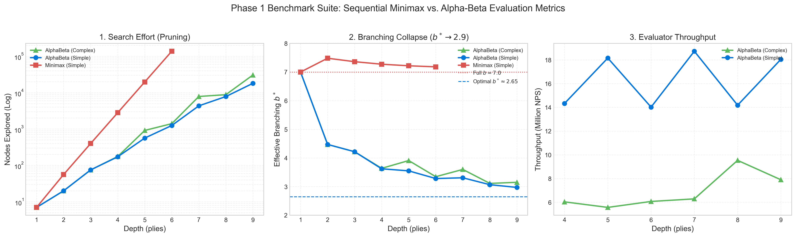

# minimax-parallel-benchmark

<p align="center">
  <strong>High-Performance Computing (HPC) research repository evaluating CPU-bound parallel game-tree search against sequential Alpha-Beta pruning and heavy heuristics.</strong>
</p>

<p align="center">
  <a href="https://github.com/a-delavega/minimax-parallel-benchmark/actions/workflows/ci.yml"></a>
  <a href="https://github.com/a-delavega/minimax-parallel-benchmark/releases"></a>
  
  
  
  
</p>

---

## 📖 Executive Summary & Motivation

In zero-sum game-tree search (such as Minimax with **Alpha-Beta (α-β) pruning**), a long-standing architectural tension exists between two primary paradigms:

1. **Raw Depth (Brute Force):** Utilizing ultra-fast, trivial leaf evaluators (𝒪(1)) to maximize node traversal speed and penetrate deep tactical horizons.
2. **Knowledge-Heavy (Complex Heuristics):** Sacrificing search depth in exchange for dense positional analysis, pattern recognition, and threat detection.

However, modern multicore CPU architectures with deep memory hierarchies (L1/L2/L3 cache) present a third, far more potent alternative: **massive parallel search**. 

Because standard Alpha-Beta pruning is inherently sequential and state-dependent (branches cannot be pruned without knowledge of bounds discovered by sibling explorations), classic parallelization schemes like mutex-guarded search trees or *Principal Variation Split* often degrade due to cache-line bouncing and lock contention.

**`minimax-parallel-benchmark`** provides an empirical, reproducible testbed designed to demonstrate how hardware-oriented parallel algorithms—specifically **Lazy SMP (Symmetric Multiprocessing)** coupled with **lockless Transposition Tables** and **Zobrist Hashing**—can decisively outscale both sequential Alpha-Beta and compute-heavy evaluation heuristics.

### The Research Testbed: Connect 4
Connect 4 offers the ideal experimental characteristics for this benchmark:
- **Dense State Space:** Approximately 4.5 × 10¹² valid game positions.
- **Moderate Branching Factor (𝑏 ≤ 7):** Allows the search tree to reliably reach deep plies (𝑑 ≥ 12), where cache locality, synchronization overhead, and tree pruning efficiency become performance-critical.
- **Compact Bitboard Encoding:** A full 7 × 6 board fits into registers and cache lines, eliminating RAM access latency and isolating pure CPU compute efficiency.

---

## 🚦 Roadmap & Implementation Status

| Phase | Milestone | Tag / Release | Status | Key Highlights |
| :--- | :--- | :---: | :---: | :--- |
| **Phase 0** | **Setup & Bitboard Core** | [`v0.1.0-phase0`](https://github.com/a-delavega/minimax-parallel-benchmark/releases/tag/v0.1.0-phase0) | ✅ Complete | 32-byte Bitboard, 𝒪(1) shifts, row-6 sentinel bits, CMake C++20 |
| **Phase 1** | **Sequential Engine & Heuristics** | [`v0.2.0-phase1`](https://github.com/a-delavega/minimax-parallel-benchmark/releases/tag/v0.2.0-phase1) | ✅ Complete | Minimax vs Alpha-Beta, ComplexEvaluator, Catch2 tests, Benchmarks |
| **Phase 2** | **Lazy SMP Concurrency (Core)** | `v0.3.0-phase2` | ⏳ Up Next | Multi-threaded search sharing [α, β] windows via `std::thread` |
| **Phase 3** | **Game Theory & Suboptimal Opponents** | `v0.4.0-phase3` | 📅 Planned | Exploitative pruning against erratic agents |
| **Phase 4** | **Transposition Tables & Zobrist Hash** | `v0.5.0-phase4` | 📅 Planned | Lock-free concurrent hash table to eliminate transpositions |
| **Phase 5** | **Real-Time Control & Iterative Deepening** | `v0.6.0-phase5` | 📅 Planned | Strict 50ms deadlines & dynamic time management |

---

## 📚 Technical Documentation & Research Reports

Comprehensive scientific and architectural documentation is available in the [`docs/`](docs/) directory:

- [**00. Introduction & Research Objectives**](docs/00_introduction_and_objectives.md): Academic motivation, zero-sum game tree theory, CPU cache hierarchy challenges, and experimental testbed characteristics.
- [**01. Phase 0: 64-bit Bitboard Core Architecture**](docs/01_phase0_bitboard_architecture.md): Sentinel bits mathematical proof, 32-byte cache line alignment, O(1) branchless win detection, and CMake C++20 build orchestration.
- [**02. Phase 1: Sequential Engine & Benchmarks**](docs/02_phase1_sequential_engine_and_benchmarks.md): Pure Minimax vs. Alpha-Beta pruning, tactical move ordering, Raw Depth vs. Heavy Evaluator trade-offs, Catch2 suite, and empirical analysis ($b^* < 3.0$).
- [**Documentation Index**](docs/README.md): Roadmap tracker and technical report catalog.

---

## 📌 Architectural Flow


---

## 🔬 Mathematical Representation: 64-bit Bitboard

The game state is represented entirely within **two 64-bit unsigned integers** (`bitboard[0]` for Player 1, `bitboard[1]` for Player 2).

### Column-Major Layout with Sentinel Bits

To eliminate array lookups and branch mispredictions, the 7x6 board is mapped using **7 bits per column** (rows 0–5 for playable cells, row 6 reserved as a **sentinel bit** always set to `0`):

```text
bit_index = column * 7 + row
```

```
  Col:    0     1     2     3     4     5     6
       +-----+-----+-----+-----+-----+-----+-----+
Row 6  |  6  | 13  | 20  | 27  | 34  | 41  | 48  |  <-- SENTINEL BITS (Always 0)
Row 5  |  5  | 12  | 19  | 26  | 33  | 40  | 47  |  <-- Top playable row
Row 4  |  4  | 11  | 18  | 25  | 32  | 39  | 46  |
Row 3  |  3  | 10  | 17  | 24  | 31  | 38  | 45  |
Row 2  |  2  |  9  | 16  | 23  | 30  | 37  | 44  |
Row 1  |  1  |  8  | 15  | 22  | 29  | 36  | 43  |
Row 0  |  0  |  7  | 14  | 21  | 28  | 35  | 42  |  <-- Bottom row
       +-----+-----+-----+-----+-----+-----+-----+
```

### Why the Sentinel Bit Matters

During diagonal win detection, bit shifts of ±6 (ascending diagonal `/`) and ±8 (descending diagonal `\`) could wrap across column boundaries and trigger false-positive 4-in-a-row detections. 

By enforcing row 6 to remain `0` permanently, any diagonal shift attempting to spill into the adjacent column is masked out by a logical `AND` with zero, ensuring correctness in O(1) with **zero branching**.

### O(1) Win Detection via Bit Shifts

A 4-in-a-row in any direction `d` is determined by two consecutive shifts:

```cpp
mask    = b & (b >> d)
has_won = (mask & (mask >> (2 * d))) != 0
```

- **Vertical**: `d = 1`
- **Horizontal**: `d = 7`
- **Diagonal (`/`)**: `d = 6`
- **Diagonal (`\`)**: `d = 8`

---

## ⚡ Thread-Safety & Memory Footprint

- `sizeof(Board)` is **32 bytes**, fitting easily within a single L1 cache line (typically 64 bytes).
- **Zero heap allocations** (`malloc`/`new`) on the search hot-path.
- **Trivially copyable:** Each parallel search thread in Phase 2 receives its own local board instance on the stack/registers, avoiding mutex synchronization and memory contention entirely during recursive tree walks.

---

## 🛠️ Build & Installation

The project requires a **C++20** compliant compiler and **CMake 3.25+**.

### Linux / WSL (GCC 11+ / Clang 13+)

```bash
# Configure and build
cmake -B build -DCMAKE_BUILD_TYPE=Release
cmake --build build -j$(nproc)

# Run test suite
ctest --test-dir build --output-on-failure

# Run interactive terminal UI
./build/mmb_runner

# Run CPU instruction microbenchmark
./build/benchmarks/mmb_micro_benchmark
```

### Windows (MSVC 2022)

```powershell
# Configure and build
cmake -B build -DCMAKE_BUILD_TYPE=Release
cmake --build build --config Release

# Run test suite
ctest --test-dir build -C Release --output-on-failure

# Run interactive terminal UI
.\build\Release\mmb_runner.exe

# Run CPU instruction microbenchmark
.\build\benchmarks\Release\mmb_micro_benchmark.exe
```

### CMake Options

| Flag | Default | Description |
|---|---|---|
| `MMB_BUILD_TOOLS` | `ON` | Build CLI debug visualizer (`pretty_print`) |
| `MMB_BUILD_TESTS` | `ON` | Build Catch2 unit test suite (`mmb_tests`) |
| `MMB_BUILD_BENCHMARKS` | `ON` | Build search benchmarks (`mmb_benchmark`) & CPU microbenchmarks (`mmb_micro_benchmark`) |

---

## 📊 Phase 1 Benchmark Analytics

Empirical search benchmarks generated by `mmb_benchmark` across opening and midgame positions:

<p align="center">
  
</p>

- **Search Space Pruning:** Alpha-Beta reduces node exploration from 137,256 nodes to 1,248 nodes at depth 6 (**99.1% search reduction**).
- **Effective Branching Factor ($b^*$):** Static and tactical center-outward move ordering collapses the effective branching factor from $b \approx 7.2$ down to $b^* \approx 2.97$, tightly converging toward the theoretical lower bound ($\sqrt{7} \approx 2.65$).
- **Throughput vs. Evaluation:** Raw depth leaf evaluation (`SimpleEvaluator`) achieves **35M – 75M NPS**, providing a ~5× raw traversal advantage over pattern-heavy heuristics (`ComplexEvaluator`: **8M – 17M NPS**).

To regenerate the high-resolution charts from `benchmark_phase1_results.csv`:
```bash
python scripts/plot_benchmarks.py
```

### CPU Instruction Microbenchmarks (`mmb_micro_benchmark`)

Low-level hardware latency and throughput measured across 10M operations:

| Microbenchmark Target | Operations | Latency (ns) | Throughput | Notes |
| :--- | :---: | :---: | :---: | :--- |
| `Board::has_won` (No Win) | 10,000,000 | **~5.5 ns** | **180 MOps/s** | Branchless 4-way diagonal/axial check |
| `Board::has_won` (Win) | 10,000,000 | **~3.2 ns** | **310 MOps/s** | Early exit bitmask bit-shift |
| `Board::make + unmake_move` | 20,000,000 | **~3.5 ns** | **285 MOps/s** | Zero-allocation stack state mutation |
| `Board::is_winning_move` | 10,000,000 | **~3.4 ns** | **295 MOps/s** | 1-ply tactical lookahead mask |
| `SimpleEvaluator::evaluate` | 10,000,000 | **~4.2 ns** | **235 MOps/s** | Pure $\mathcal{O}(1)$ terminal distance discounting |
| `ComplexEvaluator::evaluate` | 2,000,000 | **~66.7 ns** | **15 MOps/s** | 3-in-a-row threat masks + column parity |

---

## 📄 License

MIT License. See [LICENSE](LICENSE) for details.
