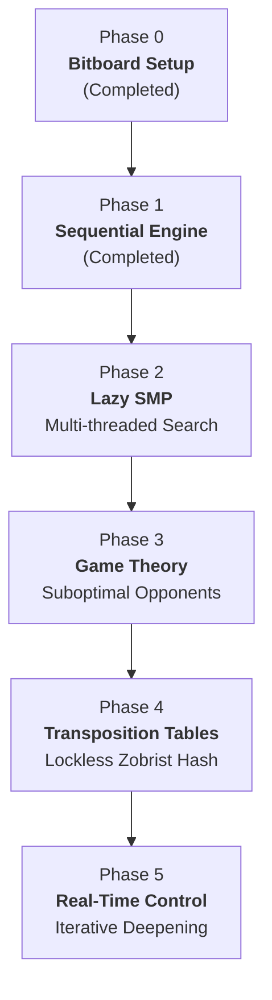

# Global Vision and Strategic Framework

**Project:** `minimax-parallel-benchmark`  
**Author:** Alejandro de la Vega  
**Date:** November 2026  
**Research Area:** High-Performance Computing (HPC), Game Theory, and Concurrent CPU Search Algorithms  

---

## 1. Global Vision & Research Motivation

### 1.1 The Fundamental Problem
In artificial intelligence applied to two-player zero-sum games with perfect information, the classical paradigm relies on the Minimax algorithm optimized via **Alpha-Beta ($\alpha$-$\beta$) pruning**. For decades, the literature has contrasted two dominant approaches to elevate an engine's decision quality:

1. **Raw Depth:** Keeping static leaf evaluations trivial and ultra-fast in $\mathcal{O}(1)$ to explore the decision tree as deeply as possible within the allotted time.
2. **Knowledge-Heavy Heuristics (Complex Evaluation):** Sacrificing search depth in favor of dense positional evaluations (pattern recognition, tactical threats, column parity, center control).

However, on modern multi-core CPU architectures featuring complex hierarchical caches (L1/L2/L3), a third and far more promising paradigm emerges: **massive parallelization of the search space**.

The critical challenge is that Alpha-Beta pruning is an **inherently sequential, state-dependent algorithm**: a worker thread cannot prune a branch efficiently without knowing the tightest bounds ($\alpha$ or $\beta$) discovered earlier by another thread. Traditional parallelization techniques—such as *Principal Variation Split* (PVSplit) or lock-based schemes (`std::mutex`)—suffer from severe memory contention, cache-line bouncing, and synchronization overhead that often neutralize or even reverse multi-threaded speedups.

### 1.2 Primary Objective
The core purpose of **`minimax-parallel-benchmark`** is to demonstrate empirically and rigorously how a hardware-oriented parallel architecture—specifically **Lazy SMP (Symmetric Multiprocessing)** combined with **Lockless Transposition Tables** and **64-bit Zobrist Hashing**—can quantitatively and qualitatively surpass both pure sequential Alpha-Beta pruning and heavy heuristic evaluations.

### 1.3 The Experimental Benchmark: Connect 4
Connect 4 serves as the ideal benchmark environment for this research:
- **Dense State Space:** Approximately $4.53 \times 10^{12}$ legal positions.
- **Moderate Branching Factor ($b \le 7$):** Allows the search to reach deep horizons ($d \ge 12$ in real time), where memory bottlenecks, cache locality, and thread concurrency limits become prominently measurable.
- **Compact Mathematical Mapping:** The $7 \times 6$ grid maps entirely into 64-bit unsigned integer registers, completely eliminating slow DRAM overhead and memory indirection artifacts.

---

## 2. Multidisciplinary Roadmap

The project is structured into 6 incremental engineering phases:

- **Phase 0 (Setup & Bitboard Core - Completed):** Zero-friction foundation. Optimal mathematical board representation using 64-bit Bitboards, $\mathcal{O}(1)$ branchless win detection with sentinel bits, zero dynamic allocations, and cross-platform CMake C++20 orchestration.
- **Phase 1 (Sequential Engine & Heuristics - Completed):** Implementation of pure Minimax and Alpha-Beta pruning with static and tactical move ordering; formal empirical comparison between raw search depth (`SimpleEvaluator`) vs. knowledge-heavy pattern heuristics (`ComplexEvaluator`), reducing effective branching factor to $b^* < 3.0$.
- **Phase 2 (Lazy SMP - The HPC Core):** Multi-threaded game-tree search using `std::jthread` / `std::thread`, where worker threads asynchronously explore the tree with search asymmetry (depth and window perturbations) without mutex contention on the hot path.
- **Phase 3 (Game Theory & Adaptability):** Adaptive exploitation against suboptimal or erratic opponents (mitigating the hyper-pessimistic minimax assumption when the adversary makes tactical blunders).
- **Phase 4 (Memory & Transposition Tables):** Pruning transposed game states across all concurrent threads using lock-free shared Transposition Tables backed by incremental 64-bit Zobrist Hashing.
- **Phase 5 (Real-Time Control & Iterative Deepening):** Strict deadline management (e.g., 50 ms per move) utilizing *Iterative Deepening Search* (IDS), aspiration windows, and asynchronous cooperative stop mechanisms.
