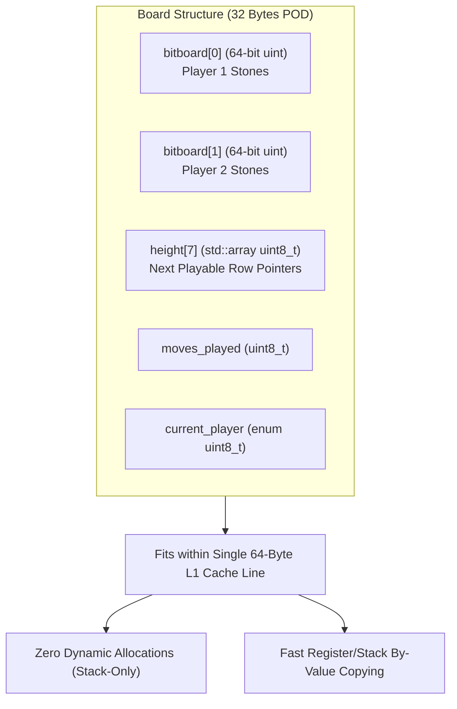

# Technical Report: Phase 0 – Bitboard Core & Mathematical Model

**Project:** `minimax-parallel-benchmark`  
**Area of Research:** High-Performance Computing (HPC), Game Theory, and Concurrent Game-Tree Search  
**Case Study:** Connect 4 ($7 \times 6$ Grid, $\approx 4.53 \times 10^{12}$ Legal Positions)  
**Standard & Toolchain:** C++20 | CMake 3.25+ (MSVC 2022 / GCC 11+ / Clang 13+)

---

## 1. Executive Summary

Phase 0 establishes the non-negotiable architectural foundation for ultra-high-throughput game-tree search. In adversarial tree search algorithms (Minimax, Alpha-Beta, Lazy SMP), the state representation is traversed hundreds of millions of times per second. Traditional representations based on 2D arrays (`char board[6][7]`) or object-oriented heap allocations introduce memory indirections, cache misses, and branch mispredictions that severely throttle search performance.

Phase 0 eliminates all dynamic memory allocations and encapsulates the entire game state in a compact, **32-byte POD (Plain Old Data) Bitboard structure** that fits squarely within a single 64-byte L1 CPU cache line.



---

## 2. Mathematical Representation: 64-bit Column-Major Bitboards

The physical Connect 4 board consists of 7 columns and 6 rows (42 cells). Rather than allocating 6 bits per column, the engine uses **7 bits per column**, dedicating row 6 permanently as a **sentinel bit**:

```text
bit_index = column * 7 + row
```

```text
  Col:    0     1     2     3     4     5     6
       +-----+-----+-----+-----+-----+-----+-----+
Row 6  |  6  | 13  | 20  | 27  | 34  | 41  | 48  |  <-- SENTINEL BITS (ALWAYS 0)
Row 5  |  5  | 12  | 19  | 26  | 33  | 40  | 47  |  <-- Top playable row
Row 4  |  4  | 11  | 18  | 25  | 32  | 39  | 46  |
Row 3  |  3  | 10  | 17  | 24  | 31  | 38  | 45  |
Row 2  |  2  |  9  | 16  | 23  | 30  | 37  | 44  |
Row 1  |  1  |  8  | 15  | 22  | 29  | 36  | 43  |
Row 0  |  0  |  7  | 14  | 21  | 28  | 35  | 42  |  <-- Bottom row
       +-----+-----+-----+-----+-----+-----+-----+
Total: 49 bits used out of 64 available in uint64_t.
```

### The Mathematical Proof of Sentinel Bits

The most critical challenge in bitboard representations of grid games is detecting diagonal alignments without false-positive column-wrapping collisions:
- **Ascending Diagonal (`/`):** A step to `(col + 1, row + 1)` corresponds to a bit shift of:
  $$((\text{col} + 1) \times 7 + (\text{row} + 1)) - (\text{col} \times 7 + \text{row}) = 7 + 1 = +8$$
- **Descending Diagonal (`\`):** A step to `(col + 1, row - 1)` corresponds to a bit shift of:
  $$((\text{col} + 1) \times 7 + (\text{row} - 1)) - (\text{col} \times 7 + \text{row}) = 7 - 1 = +6$$

#### The Column-Wrapping Problem Without Sentinels
In a 6-row packed layout (6 bits per column), a shift of $+6$ from the top cell of Column $C$ (row 5) arithmetic overflows directly into row 0 of Column $C+1$. Consequently, pieces physically on opposite sides of the board would align arithmetically, falsely registering a 4-in-a-row victory.

#### The Sentinel Guarantee
By reserving row 6 (bits 6, 13, 20, 27, 34, 41, 48) as a fixed sentinel mask always set to `0`:
1. Any diagonal shift attempting to spill from column $C$ to column $C \pm 1$ must pass through a sentinel bit.
2. Because the sentinel is permanently `0`, a bitwise `AND` operation masks out the overflow to zero in hardware.
3. Correctness is guaranteed mathematically with **zero conditional branching (`if`/`else`) and zero CPU branch mispredictions**.

---

## 3. Constant-Time $O(1)$ Win Detection

Using the cumulative double-shift technique, win detection across all 4 directions executes in a handful of CPU clock cycles:

```cpp
uint64_t mask = b & (b >> d);
bool has_won  = (mask & (mask >> (2 * d))) != 0;
```

Where displacement constant $d$ defines the alignment vector:
- **Vertical:** $d = 1$
- **Horizontal:** $d = 7$
- **Ascending Diagonal (`/`):** $d = 6$
- **Descending Diagonal (`\`):** $d = 8$

```cpp
[[nodiscard]] static constexpr bool has_won(uint64_t b) noexcept {
    // Vertical (|)
    uint64_t m = b & (b >> 1);
    if (m & (m >> 2)) return true;

    // Horizontal (-)
    m = b & (b >> 7);
    if (m & (m >> 14)) return true;

    // Diagonal ascending (/)
    m = b & (b >> 6);
    if (m & (m >> 12)) return true;

    // Diagonal descending (\)
    m = b & (b >> 8);
    if (m & (m >> 16)) return true;

    return false;
}
```

---

## 4. Hardware Alignment & Thread Safety

- **Memory Footprint:** Exact size of `sizeof(Board)` is **32 bytes**:
  - `uint64_t bitboard[2]`: 16 bytes.
  - `std::array<uint8_t, 7> height`: 7 bytes.
  - `uint8_t moves_played`: 1 byte.
  - `Player current_player`: 1 byte.
  - Alignment padding: 7 bytes.
- **Cache Locality:** Fits comfortably in a standard 64-byte L1 data cache line.
- **Zero Mutex Synchronization:** Each search worker thread copies the board by value directly into CPU registers and stack frames without heap fragmentation or false sharing.

---

## 5. Cross-Platform Build System (C++20 & CMake 3.25+)

The build pipeline enforces maximum optimization flags across platforms:
- **Windows (MSVC):** `/O2` (maximum speed), `/GL` (whole program optimization), `/LTCG` (link-time code generation) for aggressive bitwise inlining.
- **Linux / macOS (GCC / Clang):** `-O3`, `-march=native` (enabling hardware `POPCNT` and AVX2 vector instructions), and `-pthread`.
- **Modular Targets:**
  - `minimax_core`: Interface library providing zero-overhead C++20 abstractions.
  - `mmb_runner`: CLI driver and smoke test.
  - `pretty_print`: Terminal ASCII debug tool.
  - `mmb_tests`: Integrated test runner (Catch2 / CTest).
  - `mmb_benchmark`: Standalone performance benchmarking harness.
