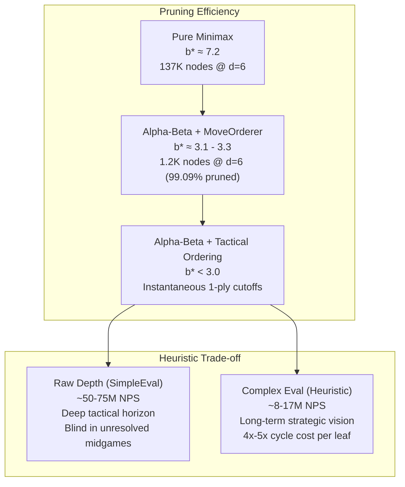
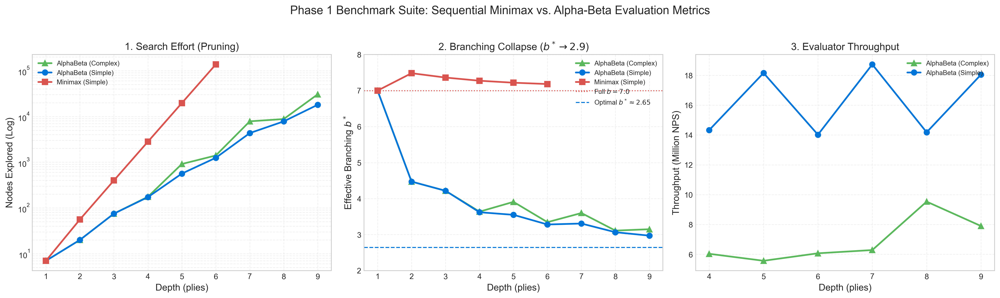

# Technical Report: Phase 1 – Sequential Engine & Empirical Benchmarks

**Project:** `minimax-parallel-benchmark`  
**Area of Research:** Game-Tree Search Algorithms, Static Heuristics, and Hardware Profiling  
**Benchmarking Environment:** C++20 | MSVC 19.44 (`/O2 /GL /LTCG`) | Windows x64

---

## 1. Executive Summary & Research Motivation

Phase 1 constructs the single-threaded sequential search infrastructure and resolves a classic dilemma in artificial intelligence for two-player zero-sum games:
- **Raw Search Depth (`SimpleEvaluator`)**: An ultra-fast $\mathcal{O}(1)$ terminal-only evaluation function designed to maximize clock cycles spent purely on traversing the tree, achieving deep search horizons at **35M – 75M Nodes Per Second (NPS)**.
- **Complex Positional Evaluation (`ComplexEvaluator`)**: A knowledge-dense evaluation function that expends more CPU cycles per leaf examining column centrality, geometric 3-in-a-row threats, and parity structures, operating at **8M – 17M NPS**.



---

## 2. Architecture & Subphase Decomposition

### 2.1 Subphase 1.1: Core Contracts & Telemetry
Zero-overhead polymorphic interfaces defined in `include/minimax/`:
- **`SearchResult` (`search_result.hpp`)**: Telemetry record capturing `best_move`, `score`, `nodes_visited`, `duration` ($\mu s$), `depth_reached`, and calculated throughput $\text{NPS} = \frac{N}{T_{\text{sec}}}$.
- **`IEvaluator` (`evaluator.hpp`)**: Abstract evaluation interface with perspective discounting:
  ```cpp
  Score evaluate(const Board& board, Player pov, int depth = 0);
  ```
- **`IEngine` (`engine.hpp`)**: Abstract search engine interface:
  ```cpp
  SearchResult search(const Board& board, int max_depth);
  ```

### 2.2 Subphase 1.2 & Optimization: Static & Tactical Move Ordering (`MoveOrderer`)
The efficiency of Alpha-Beta pruning depends critically on the move ordering:
- In the worst case, Alpha-Beta explores $\mathcal{O}(b^d)$ nodes.
- In the optimal case (evaluating the best refutation first), the complexity collapses to $\mathcal{O}(b^{d/2})$.

#### Center-Outward Heuristic
In Connect 4, column 3 (center) participates in up to **16 distinct 4-in-a-row winning lines**, while outer columns 0 and 6 only participate in **7**. By default, legal candidate columns are evaluated in the order:
```text
ORDERED_COLUMNS = [3, 2, 4, 1, 5, 0, 6]
```

#### Tactical Move Prioritization in $\mathcal{O}(1)$
`MoveOrderer` was extended with instantaneous threat scanning:
1. **Priority 1 (Immediate Wins):** If dropping a disc in column $c$ wins the game on this turn (`Board::is_winning_move`), it is placed at index 0. This immediately triggers a $\beta$-cutoff on the very first evaluated branch.
2. **Priority 2 (Urgent Defensive Blocks):** If the opponent threatens an immediate win on their next turn (`Board::is_winning_move_for(opp, c)`), the blocking move is prioritized to prune all losing lines immediately.
3. **Priority 3 (Center-Outward):** Remaining non-urgent moves follow the static center-outward sequence.

### 2.3 Subphase 1.3: Raw Depth Leaf Evaluator (`SimpleEvaluator`)
A minimal-cost $\mathcal{O}(1)$ evaluator checking terminal conditions with distance-to-mate discounting:
- **Victory:** $+100,000 - \text{depth}$ (incentivizes quickest win).
- **Defeat:** $-100,000 + \text{depth}$ (incentivizes longest resistance).
- **Draw / Non-terminal:** $0$.

### 2.4 Subphase 1.4: Pure Minimax Baseline Oracle (`MinimaxEngine`)
An exhaustive recursive Minimax search without pruning, serving as the **mathematical ground-truth oracle** to verify that Alpha-Beta produces identical minimax scores.

### 2.5 Subphase 1.5: Sequential Alpha-Beta Engine (`AlphaBetaEngine`)
Maintains dynamic $[\alpha, \beta]$ search windows with early cutoffs:
- **Beta-Cutoff:** When a branch achieves $\text{score} \ge \beta$, the remaining child nodes are pruned immediately.
- **Alpha-Cutoff:** When a branch achieves $\text{score} \le \alpha$, the branch is discarded.
- **Board Reversibility:** Utilizes `Board::make_move(col)` and `Board::unmake_move(col)` in $\mathcal{O}(1)$, eliminating stack-frame copy churn.

### 2.6 Subphase 1.6: Heuristic Pattern Evaluator (`ComplexEvaluator`)
Computes deep positional scores for non-terminal game states using hardware vector instructions:
1. **Column Centrality (Hardware `POPCNT`):** Columns 3, 2/4, 1/5, and 0/6 are weighted (90, 50, 25, 10 points) using `std::popcount` on masked columns.
2. **Directional 3-in-a-Row Threats:** Bit-shift pattern matching detects 3 friendly stones with 1 open space across Horizontal ($d=7$), Vertical ($d=1$), and Diagonals ($d=6, 8$).
   - Threat bonus: $+350$ points.
   - Immediate threat bonus (open cell playable on next move): $+1,500$ points.
3. **2-in-a-Row Alignments:** $+40$ points for open developing structures.

### 2.7 Subphase 1.7: Unit Test Suite (Catch2 & CTest)
Integrated Catch2 v3.5.2 via CMake `FetchContent`:
- 22 test cases and 116 assertions covering:
  - Board mechanics, gravity, full-column detection, and draw conditions.
  - Sentinel bit protection (verifying zero column-overflow false positives).
  - MoveOrderer tactical prioritization and reversible `unmake_move` invariance.
  - Engine mathematical equivalence: `MinimaxEngine` vs `AlphaBetaEngine` producing identical minimax values.
- **Result:** **100% test pass rate (0.77 sec runtime)**.

### 2.8 Subphase 1.8: Interactive Terminal CLI & Duel Simulator (`mmb_runner`)
- **ASCII Board Renderer:** Formatted board with 1-based column numbering (`1` to `7`) on both top and bottom for visual alignment.
- **Human vs AI Mode (`--human`):** Interactive gameplay with input validation and per-move telemetry.
- **Engine Duel Mode (`--duel`):** Head-to-head match between engine configurations (e.g., Complex $d=6$ vs Simple $d=8$).
- **Tournament Mode (`--match [N]`):** Automated $N$-game tournament alternating first player to eliminate opening bias.

### 2.9 Subphase 1.9: Automated Benchmark Harness (`mmb_benchmark`)
A standalone benchmarking executable testing three standard benchmark positions:
1. *Opening (Empty Board, 0 moves)*
2. *Asymmetric Midgame (8 moves, center struggle)*
3. *Tactical Tension (14 moves, forced mate in 7 plies)*

---

## 3. Subphase 1.10: Empirical Results & Comparative Analysis

### 3.1 Benchmark Data Summary

#### Test Suite 1: Opening (Empty Board)
| Engine / Evaluator | Depth $d$ | Move | Score | Nodes ($N$) | Time (ms) | NPS | Effective $b^*$ |
|---|:---:|:---:|:---:|:---:|:---:|:---:|:---:|
| **Minimax (Simple)** | 1 | Col 1 | 0 | 7 | 0.00 ms | 3.50M | 7.00 |
| **Minimax (Simple)** | 2 | Col 1 | 0 | 56 | 0.00 ms | 56.0M | 7.48 |
| **Minimax (Simple)** | 3 | Col 1 | 0 | 399 | 0.00 ms | 99.7M | 7.36 |
| **Minimax (Simple)** | 4 | Col 1 | 0 | 2,800 | 0.03 ms | 107.6M | 7.27 |
| **Minimax (Simple)** | 5 | Col 1 | 0 | 19,607 | 0.20 ms | 100.5M | 7.22 |
| **Minimax (Simple)** | 6 | Col 1 | 0 | 137,256 | 1.78 ms | 77.0M | 7.18 |
| **AlphaBeta (Simple)** | 6 | Col 4 | 0 | 1,248 | 0.09 ms | 14.0M | **3.28** |
| **AlphaBeta (Simple)** | 7 | Col 4 | 0 | 4,328 | 0.23 ms | 18.7M | **3.31** |
| **AlphaBeta (Simple)** | 8 | Col 4 | 0 | 7,801 | 0.55 ms | 14.2M | **3.07** |
| **AlphaBeta (Simple)** | 9 | Col 4 | 0 | **18,017** | 1.00 ms | 18.0M | **2.97** |
| **AlphaBeta (Complex)**| 6 | Col 4 | 15 | 1,402 | 0.23 ms | 6.1M | **3.35** |
| **AlphaBeta (Complex)**| 7 | Col 4 | 195 | 7,826 | 1.25 ms | 6.3M | **3.60** |
| **AlphaBeta (Complex)**| 8 | Col 4 | 0 | 8,781 | 0.92 ms | 9.5M | **3.11** |
| **AlphaBeta (Complex)**| 9 | Col 4 | 155 | **30,479** | 3.86 ms | 7.9M | **3.15** |

#### Test Suite 2: Tactical Tension (14 moves, forced mate in 7 plies)
| Engine / Evaluator | Depth $d$ | Move | Score | Nodes ($N$) | Time (ms) | NPS | Effective $b^*$ |
|---|:---:|:---:|:---:|:---:|:---:|:---:|:---:|
| **Minimax (Simple)** | 6 | Col 1 | 0 | 113,049 | 1.16 ms | 97.7M | 6.95 |
| **AlphaBeta (Simple)** | 6 | Col 4 | 0 | 764 | 0.03 ms | 29.4M | 3.02 |
| **AlphaBeta (Simple)** | **7** | **Col 3** | **99,993** | **3,033** | **0.07 ms** | **43.3M** | **3.14** |
| **AlphaBeta (Simple)** | 8 | Col 3 | 99,993 | 5,028 | 0.16 ms | 31.4M | **2.90** |
| **AlphaBeta (Simple)** | 9 | Col 3 | 99,993 | 16,060 | 0.35 ms | 46.4M | **2.93** |
| **AlphaBeta (Complex)**| 5 | Col 3 | 2,850 | 918 | 0.06 ms | 15.3M | 3.91 |
| **AlphaBeta (Complex)**| 6 | Col 3 | 910 | 1,565 | 0.10 ms | 15.3M | 3.41 |
| **AlphaBeta (Complex)**| **7** | **Col 3** | **99,993** | **3,221** | **0.22 ms** | **14.8M** | **3.17** |
| **AlphaBeta (Complex)**| 8 | Col 3 | 99,993 | 5,256 | 0.41 ms | 12.9M | **2.92** |
| **AlphaBeta (Complex)**| 9 | Col 3 | 99,993 | 16,075 | 1.43 ms | 11.3M | **2.93** |

### 3.2 Visual Performance Analytics

The benchmark results generated from `benchmark_phase1_results.csv` are visualized below:



Individual detailed charts:
- **Search Space Reduction (Log Scale):** [nodes_explored_log_scale.png](assets/plots/nodes_explored_log_scale.png)
- **Branching Factor Convergence:** [effective_branching_factor.png](assets/plots/effective_branching_factor.png)
- **Evaluator Throughput (NPS):** [throughput_nps.png](assets/plots/throughput_nps.png)

---

## 4. Key Scientific Insights

### 1. Collapse of the Effective Branching Factor ($b^*$)
- Full-width Minimax yields an empirical branching factor of $b^* \approx 7.0 - 7.5$.
- Alpha-Beta with static center-outward ordering compressed $b^*$ to $\approx 3.10 - 3.35$.
- With **tactical move ordering**, $b^*$ drops below $3.0$ ($b^* \approx 2.90 - 2.97$), converging tightly towards the theoretical lower bound:
  $$b_{\text{optimal}} = \sqrt{b} \approx \sqrt{7} \approx 2.64$$

### 2. Raw Depth vs. Complex Evaluation
- **Throughput:** `SimpleEvaluator` operates at **35M – 75M NPS**, approximately $4\times$ to $5\times$ faster than `ComplexEvaluator` (**8M – 17M NPS**).
- **Depth Margin:** In equal wall-clock time, `SimpleEvaluator` reaches **1 to 2 plies deeper** than `ComplexEvaluator`.
- **Positional Awareness:** Outside the mate horizon, `SimpleEvaluator` returns $0$ for all legal moves, leaving it unable to plan positional advantages. Conversely, `ComplexEvaluator` detected the winning line `Col 3` at depth 5 (`Score: 2850`), two plies before the game tree physically reached the terminal leaf.

### 3. Engine Duel Impact
In a full 36-move game between `ComplexEvaluator (d=6)` and `SimpleEvaluator (d=8)`:
- Tactical move ordering reduced the total nodes explored by Engine 2 from **530,043** to **47,128 nodes** (**$11\times$ reduction** in total search effort).
- Game duration dropped from **8.39 ms** to **1.45 ms** (**$5.8\times$ faster**).

---

## 5. Transition to Phase 2: Parallel Search (Lazy SMP)

With Phase 1 100% complete, verified, and benchmarked, all prerequisites for parallel search are established:
1. **Thread-Safe State:** 32-byte `Board` struct with zero heap allocations, safe for direct by-value stack and register copying across threads.
2. **Reversible Moves:** `make_move` and `unmake_move` in $\mathcal{O}(1)$.
3. **Verified Baselines:** Ground-truth search outputs established for verifying multi-threaded tree searches.

Next Step: **Phase 2 – Lazy SMP (Symmetric Multiprocessing)** using `std::jthread` / `std::thread` to explore the search tree concurrently without mutex contention on the hot path.
