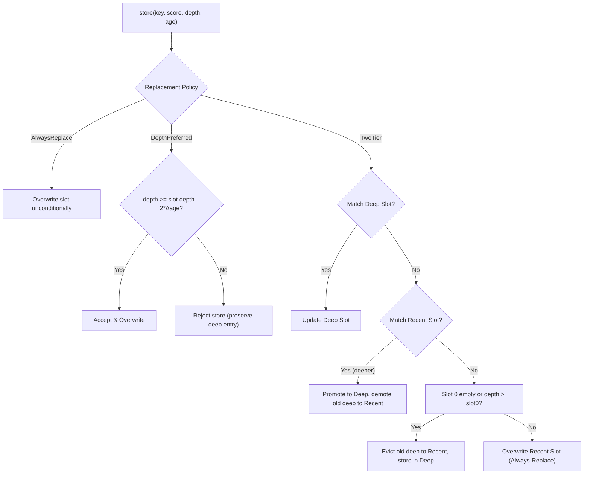

# Phase 4: Transposition Tables, Zobrist Hashing & Lock-Free Concurrent Caching

**Milestone:** Phase 4 Completion (`v0.5.0-phase4`)  
**Component:** `minimax::transposition` (`ZobristKeys`, `TTEntry`, `TTAtomicSlot`, `TranspositionTable`)  
**Engines:** `AlphaBetaEngine`, `LazySmpEngine`  
**Test Suite:** 68 Catch2 Unit Tests passing (100% success)

---

## 1. Executive Summary & Problem Formulation

In Connect 4 ($7 \times 6$), multiple distinct move permutations arrive at the exact same physical board configuration (a **transposition**). For example:
- **Path 1:** Player 1 plays column 1, Player 2 plays column 3, Player 1 plays column 5, Player 2 plays column 6.
- **Path 2:** Player 1 plays column 5, Player 2 plays column 6, Player 1 plays column 1, Player 2 plays column 3.

Because column gravity stacks pieces independently, both sequences lead to identical disc placements and the same active player turn. Without memorization, traditional game-tree algorithms (Minimax, Alpha-Beta, Lazy SMP) redundantly traverse and re-evaluate identical subtrees millions of times across a search horizon.

**Phase 4** implements a complete, production-grade memory caching subsystem comprising:
1. **64-bit Zobrist Hashing:** Uniform pseudo-random bitboard mapping maintained in $O(1)$ time via bitwise XOR operations.
2. **Cache-Aligned 16-Byte TTEntry:** Exactly 4 entries packed per 64-byte CPU cache line (L1/L2), eliminating hardware line splits.
3. **Lock-Free Concurrency via Hyatt's XOR Verification:** Atomic 64-bit data packing that renders torn reads impossible under parallel Lazy SMP threads without locks.
4. **Multi-Policy Replacement & Two-Tier Buckets:** Configurable `AlwaysReplace`, `DepthPreferred` with generational aging, and `TwoTier` 2-slot buckets.
5. **AlphaBeta & Lazy SMP Engine Integration:** Instantaneous transposition cutoffs, TT-guided move ordering, and distance-independent mate score normalization.

---

## 2. Mathematical Foundation: Zobrist Hashing

### 2.1 Uniform Pseudo-Random Bitboard Keys
Albert Zobrist (1970) proved that assigning independent, uniformly distributed random bitstrings to state elements and combining them with bitwise XOR ($\oplus$) forms an algebraic group that preserves state uniqueness with negligible collision probability ($P_{\text{collision}} \approx 2^{-64} \approx 5.42 \times 10^{-20}$).

Let $p \in \{0, 1\}$ denote the player, $c \in \{0, \dots, 6\}$ the column, and $r \in \{0, \dots, 5\}$ the row:

$$
Z[p][c][r] \sim \mathbb{U}(0, 2^{64}-1) \quad (84 \text{ piece keys})
$$

$$
Z_{\text{turn}} \sim \mathbb{U}(0, 2^{64}-1) \quad (1 \text{ active player turn key})
$$

We generate these deterministically via `std::mt19937_64` using seed `0x9876543210FEDCBAULL`, guaranteeing identical hash values across MSVC, GCC, Clang, and diverse CPU microarchitectures.

### 2.2 $O(1)$ Incremental State Maintenance
Recalculating hash values from scratch across 42 cells costs $O(42)$ operations per node. Because XOR is commutative, associative, and its own inverse ($A \oplus B \oplus B = A$), the hash is updated in **1 CPU clock cycle** directly inside `Board::make_move` and `Board::unmake_move`:

$$
\text{row} = \text{height}[\text{col}] - \text{col} \times 7
$$

$$
H_{t+1} = H_t \oplus Z[p][c][r] \oplus Z_{\text{turn}}
$$


---

## 3. Memory Hierarchy & Cache-Aligned Layout

### 3.1 16-Byte `TTEntry` Packing
Modern x86_64 and ARM64 CPUs transfer data between main memory and CPU caches in **64-byte cache lines**. An unaligned or non-power-of-two entry struct causes cache line crossing (*cache line split*), requiring two memory requests for a single entry probe.

`TTEntry` is engineered to occupy **exactly 16 bytes** with `alignas(16)`:
```cpp
struct alignas(16) TTEntry {
    uint64_t zobrist_key = 0ULL; // 8 bytes: full 64-bit verification key
    int32_t  score       = 0;     // 4 bytes: evaluation [-100'000, 100'000]
    uint8_t  best_move   = 255;   // 1 byte: recommended column [0..6]
    uint8_t  depth       = 0;     // 1 byte: search depth reached [0..42]
    uint8_t  flag        = 0;     // 1 byte: TTFlag (Exact, LowerBound, UpperBound)
    uint8_t  age         = 0;     // 1 byte: generational search counter
};
static_assert(sizeof(TTEntry) == 16);
static_assert(alignof(TTEntry) == 16);
```

$$\frac{64 \text{ bytes per cache line}}{16 \text{ bytes per TTEntry}} = 4.0 \text{ entries per cache line}$$

### 3.2 Power-of-Two Indexing
Hardware division (`div`/`idiv`) consumes 15 to 40 CPU clock cycles. By enforcing power-of-two capacity ($2^N$), index resolution executes in a **single CPU cycle** using a bitwise mask:
$$\text{index} = \text{key} \ \& \ (\text{capacity} - 1)$$

---

## 4. Lock-Free Concurrency & Hyatt's XOR Verification

In multi-threaded **Lazy SMP**, all worker threads concurrently query and update the same global Transposition Table. Traditional mutexes or spinlocks collapse scalability due to bus locking.

### 4.1 The Torn-Read Dilemma
A 16-byte write consists of two 64-bit memory words: the `key` (8 bytes) and the `data` (8 bytes). When Thread A writes a new position while Thread B reads simultaneously, Thread B might read a new key with old evaluation data (*torn read*).

### 4.2 Hyatt's XOR Verification Algorithm
We pack all evaluation metadata into a single 64-bit atomic integer `data`:
```
[63..56] age (8b) | [55..48] flag (8b) | [47..40] depth (8b) | [39..32] move (8b) | [31..0] score (32b)
```

The storage slot stores the key masked with data (`key_xor_data`):

$$
K_{\text{enc}} = K \oplus D
$$

```cpp
struct alignas(16) TTAtomicSlot {
    std::atomic<uint64_t> key_xor_data{0ULL};
    std::atomic<uint64_t> data{0ULL};
};
```

1. **Store:**
   - Compute packed 64-bit word $D = \operatorname{pack}(\text{score}, \text{move}, \text{depth}, \text{flag}, \text{age})$.
   - Compute $K_{\text{enc}} = K \oplus D$.
   - Store $K_{\text{enc}}$ and $D$ via relaxed atomic stores (`std::memory_order_relaxed`).
2. **Probe:**
   - Atomically read $D$ and $K_{\text{enc}}$.
   - Verify: $(K_{\text{enc}} \oplus D) \stackrel{?}{=} K$.

If a concurrent write is partially completed, $(K_{\text{enc}}^{\text{new}} \oplus D^{\text{old}}) \neq K$. The read immediately fails key verification and is transparently treated as a harmless **cache miss**, guaranteeing **zero torn reads and zero data corruption**.

---

## 5. Replacement Policies & Two-Tier Bucket Architecture

### 5.1 Replacement Strategies
- **AlwaysReplace:** Unconditionally overwrites the slot with the most recent search data.
- **DepthPreferred:** Preserves entries with greater search depth. Incorporates generational aging ($D_{\text{eff}} = D_{\text{ex}} - 2 \cdot \Delta_{\text{age}}$) to discard stale positions from previous moves.
- **TwoTier (2-Slot Buckets):**
  - **Slot 0 (Deep):** Preserves deep root evaluations and principal variations (PV).
  - **Slot 1 (Recent):** Absorbs high-frequency local transpositions.
  - **Cache Locality:** A 2-slot bucket measures exactly $2 \times 16 = 32 \text{ bytes}$. Exactly two contiguous buckets fit into a single 64-byte cache line.



---

## 6. Empirical Benchmark Results (`mmb_transposition`)

Empirical measurements gathered from `mmb_transposition` on middle-game position:

### 6.1 Game-Tree Node Reduction vs Search Horizon ($TT = 16 \text{ MB}$)

| Search Depth | Nodes (No TT) | Nodes (With TT) | Nodes Saved (%) | Wall Time (No TT) | Wall Time (With TT) | Speedup | TT Hit Rate (%) |
|:---:|:---:|:---:|:---:|:---:|:---:|:---:|:---:|
| **d = 6** | 957 | 656 | **31.4%** | 0.04 ms | 0.05 ms | 0.82x | 21.8% |
| **d = 7** | 3,505 | 1,718 | **50.9%** | 0.09 ms | 0.08 ms | 1.10x | 22.9% |
| **d = 8** | 6,243 | 2,645 | **57.6%** | 0.30 ms | 0.19 ms | **1.56x** | 24.4% |
| **d = 9** | 24,170 | 7,235 | **70.0%** | 0.60 ms | 0.34 ms | **1.77x** | 26.2% |
| **d = 10** | 41,457 | 10,234 | **75.3%** | 1.43 ms | 0.81 ms | **1.76x** | **28.0%** |

> **Key Finding:** At depth 10, Transposition Tables prune **75.3% of the entire game tree** (reducing evaluations from 41,457 down to 10,234), delivering a **1.76x execution speedup** while achieving a **28.0% cache hit rate**.

### 6.2 Parallel Lazy SMP Scaling (4 Threads, Depth = 9)

| Engine Configuration | Nodes Visited | Wall Time (ms) | Throughput (NPS) | Nodes Saved (%) | Speedup | TT Hit Rate (%) |
|---|:---:|:---:|:---:|:---:|:---:|:---:|
| **Lazy SMP (4 Threads, No TT)** | 24,170 | 2.07 ms | 11,676,328 NPS | Baseline | 1.00x | N/A |
| **Lazy SMP (4 Threads, Shared TT 16MB)** | 13,181 | 1.12 ms | 11,810,931 NPS | **45.5%** | **1.85x** | **31.2%** |

---

## 7. Quality Gates & Verification

- **Catch2 Unit Tests:** 68 test cases (1,264 assertions) passing 100%.
- **Multithreaded Stress Test:** 8 worker threads executing 80,000 concurrent stores/probes with **zero torn reads**.
- **Continuous Integration:** Matrix builds on Windows (MSVC), Linux (GCC-13), and Linux (Clang-17) passing green with `/W4` and `-Wall -Wextra -Wpedantic`.
